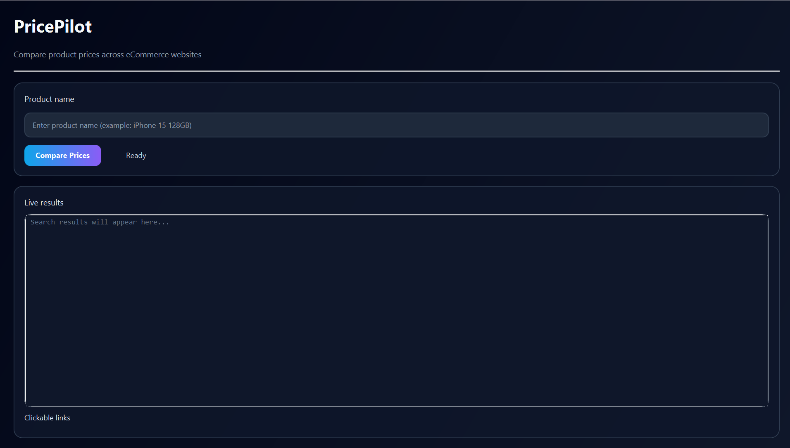
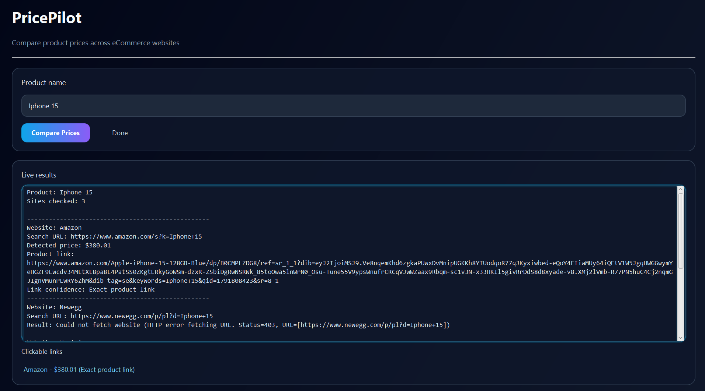
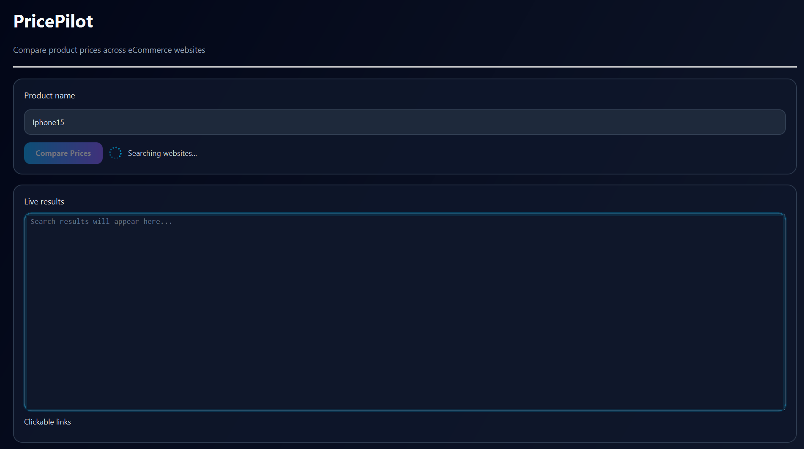

# PricePilot — JavaFX Web Price Scraper

**An academic desktop application for experimenting with product-price extraction and comparison using Java, JavaFX, and Jsoup.**

PricePilot accepts a product search term, requests search pages from configured e-commerce websites, and attempts to extract prices from the returned HTML. When prices are found, it lists them **from lowest to highest**, identifies the lowest *detected* price, and provides clickable links for manual verification.

> **Project status: Prototype / work in progress.** PricePilot does not guarantee that extracted prices match the intended product or reflect current checkout prices. It is a learning project, not a production-ready shopping recommendation service.

## Screenshots

### Main interface



### Example search results



The example above demonstrates the app's current behaviour, **not** a verified cross-retailer comparison. A detected price may be inaccurate; a retailer may deny automated access (for example, HTTP 403).

### Search in progress



## Features

- Desktop interface built with **JavaFX**, including a search field, search-status indicator, result panel, and clickable links.
- Background execution of website requests to keep the user interface responsive.
- Search-page requests configured for **Amazon, Newegg, and Wayfair**.
- HTML parsing and heuristic price extraction using **Jsoup** and CSS selectors.
- Sorting of detected prices in **ascending order (lowest first)**.
- Display of unavailable-site and failed-request messages.

**Note:** A configured website is not necessarily a reliably supported website. Availability and extraction success depend on its access controls and HTML structure.

## Tech stack

| Technology | Use |
| --- | --- |
| Java | Application logic |
| JavaFX 22.0.2 | Desktop graphical user interface |
| Jsoup 1.17.2 | HTTP requests and HTML parsing |
| Apache Maven | Build and dependency management |
| IntelliJ IDEA | Development environment |

The prepared `pom.xml` specifies **Java 21 as the compilation target** (`maven.compiler.release=21`). The application has also been run locally using **JDK 22**. You can use JDK 22 to build and run this version; do not change the Maven compiler target unless you have a reason to do so and have tested the change.

## How to run

### Requirements

- **JDK 22** (the local JDK used by the developer; the Maven compilation target is Java 21)
- **Apache Maven**, or an IntelliJ IDEA installation with Maven support
- Internet access to attempt live website requests

### IntelliJ IDEA

1. Clone or download the repository.
2. Open the folder containing `pom.xml` in **IntelliJ IDEA**.
3. Let IntelliJ import the Maven project and download its dependencies.
4. Select your installed **JDK 22** as the Project SDK and Maven runner JDK.
5. In the Maven tool window, run the `javafx:run` goal, or open a terminal in the project folder and run:

   ```bash
   mvn clean javafx:run
   ```

6. Enter a product name (for example, `iPhone 15`) and click **Compare Prices**.
7. Review the extracted results, any error messages, and the associated links. Verify any price on the original retailer website.

The application starts through `AppLauncher.java`; its JavaFX interface and scraping logic are in `MyScraper.java`.

## Project structure

```text
PricePilot_GitHub_Starter/
├── src/
│   └── main/
│       └── java/
│           ├── AppLauncher.java
│           └── MyScraper.java
├── screenshots/
│   ├── main-interface.png
│   ├── search-results.png
│   └── searching.png
├── pom.xml
├── .gitignore
└── README.md
```

## Known limitations

- **Product identity is not fully verified.** The fallback matching logic can associate a detected price with a different item on a results page.
- **Product links are not independently validated.** The interface may label a URL an "Exact product link" without confirming it matches the query.
- **Website blocking and dynamic content.** Retailers may return HTTP 403, change their page markup, or render information through JavaScript that Jsoup does not execute.
- **Limited price interpretation.** The current extraction targets USD-style prices and does not normalise currencies, shipping fees, taxes, product condition, or variants.
- **No automated test suite is included** in this version.

## Planned improvements

- Improve product-title and product-variant matching before comparing prices.
- Distinguish verified product pages from search-result links.
- Add offline tests using saved HTML samples, as well as clearer handling of missing or invalid prices.
- Improve site-specific extraction and error reporting.
- Refine the interface and project structure as the prototype develops.

## About this project

PricePilot is an **individual academic Java project** developed to practise desktop application development, HTTP/HTML processing, basic data extraction, and comparison logic. It remains under active development.
